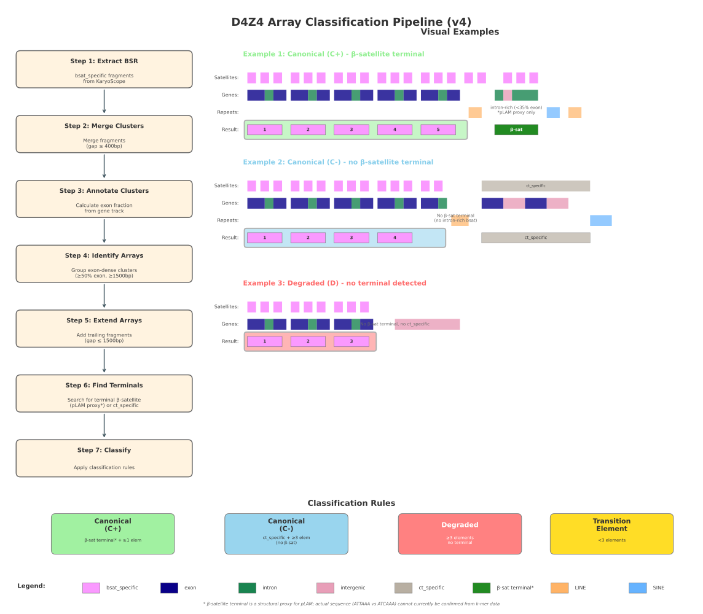

> **Snapshot note (KaryoScope-paper-code).** Copied from `barthel-lab/HPRC-D4Z4` at
> `77e804b`, the head of PR #1 (`figures/reproducible-layout`), which is not merged,
> with `figure_build.py`, `figure_compose.py`, `figure_schematic.py`, and
> `figures_layout.yaml` taken from `52ed8cc`, the head of PR #2 (`nature/ed-spec`, on
> top of PR #1, not merged): the figures are drawn at 183 mm wide with 5-7 pt text and
> 8 pt lowercase panel letters. PR #2 changes no data or analysis. Other changes: the
> home-directory defaults in `analyze_d4z4_arrays.py` (now `D4Z4_BASE_DIR`, default
> `.`), `plot_d4z4_arrays.py`, `plot_hmm_correlation.py`, and
> `generate_notable_samples_report.py` are relative to the working directory, and
> cluster paths use the variables in the repository README.
> Two inputs of the figures are not in a public location: the HMM repeat counts
> (`Hailey-notes/HPRC_chr4_counts.xlsx`) and the pLAM BLAST calls behind
> `results/d4z4_array_coordinates.plam.tsv`. With them, `make_figures.py` run in
> `environment/d4z4.yml` gives the same `figure_data.tsv` and the same drawn elements
> and values as the submitted Fig. 4, Extended Data Fig. 8, and Supplementary Fig. 2.
>
> **The revised manuscript reports the haplotypes that pass the array-focused assembly QC
> filter** (209 chromosome 4 and 299 chromosome 10 haplotypes, see [Assembly QC](#assembly-qc)),
> and uses all 582 only in sensitivity analyses. This README was written for the source
> repository. It has been updated where it described the first-submission analysis.

# HPRC D4Z4 Array Analysis

Analysis of D4Z4 repeat arrays on chr4q and chr10q subtelomeric regions across the Human Pangenome Reference Consortium (HPRC) samples using KaryoScope k-mer annotations.

## Recent Changes

**October 2026: assembly QC and hand-off**
- `d4z4_assembly_qc.py` (new): downloads the HPRC Release 2 assembly QC calls made from reads (HMM-Flagger v1.2.0 conservative calls from PacBio HiFi and ONT reads, and NucFlag v0.3.3 calls from HiFi reads) for all 582 haplotypes, and assigns each flagged interval to the D4Z4 array, terminal element, or flanks. See [Assembly QC](#assembly-qc).
- `d4z4_qc_sensitivity.py` (new): recomputes the manuscript's headline D4Z4 numbers with and without QC filtering.
- `export_haplotype_classification.py` (new): one row per haplotype with its Fig. 4b (waffle) category, manuscript category, pLAM status, and QC pass/fail. Output: `results/d4z4_haplotype_classification.tsv`.
- `create_d4z4_figure.py`: panel H (haplotype asymmetry) now uses only individuals where both haplotypes carry a single array (n = 201 pairs over all 582 haplotypes, and n = 159 in the QC set used in the revised manuscript).
- Results Summary below updated to the current classification (it previously listed 6 FSHD1-like haplotypes, and the current count is 3).

**Earlier (March–April 2026)**: figure assembly scripts (`assemble_figures.py`, `create_d4z4_figure.py`, `create_d4z4_supp1.py`, `create_d4z4_supp2.py`), pLAM integration (`extract_array_coordinates.py`), variability and population analyses. See `git log` for details.

## Background

D4Z4 is a macrosatellite repeat array located at the subtelomeric regions of chromosomes 4 and 10. Each D4Z4 repeat unit is ~3.3kb and contains the DUX4 gene. Contraction of the D4Z4 array on chromosome 4 to ≤10 repeat units, combined with a permissive genetic background (4qA haplotype with intact pLAM/polyadenylation signal), causes Facioscapulohumeral Muscular Dystrophy type 1 (FSHD1).

### Key Terminology

| Term | Description |
|------|-------------|
| **BSR** | Beta Satellite Repeat - the ~2.3kb satellite DNA element within each D4Z4 unit |
| **pLAM** | Polyadenylation signal region distal to the D4Z4 array. A pLAM hit is called functional when it matches the canonical pLAM sequence, which contains the ATTAAA polyadenylation signal, exactly. Any other hit is called non-functional, and most of these still contain ATTAAA. **Note**: This pipeline detects terminal β-satellite as a structural proxy for pLAM presence. The actual pLAM sequence cannot be determined from k-mer annotations alone (see [Limitations](#limitations)). |
| **4qA (C+)** | Haplotype with terminal β-satellite detected - suggests pLAM presence and FSHD risk on chr4 |
| **4qB (C-)** | Haplotype without terminal β-satellite (ct_specific terminal only) |
| **10qA/10qB** | Equivalent haplotypes on chromosome 10. Note: Some 10qA haplotypes have terminal β-satellite but a non-functional pLAM call, so chr10 arrays are not associated with FSHD regardless of terminal type. |
| **D** | Degraded array - no detectable terminal (neither β-satellite nor ct_specific) |

## Directory Structure

```
HPRC-D4Z4/
├── data/                    # KaryoScope BED files (NOT in git, see below)
│   └── plam/                # BLAST pLAM coordinates from Hailey Loucks (NOT in git)
├── Hailey-notes/            # HMM repeat counts (HPRC_chr4_counts.xlsx) (NOT in git)
├── results/                 # All outputs (NOT in git)
│   └── d4z4_assembly_qc/    # QC intervals, scenarios, cached QC BEDs
├── analyze_d4z4_arrays.py           # 1. Array calling and classification
├── extract_array_coordinates.py     # 2. Per-array coordinates + pLAM merge
├── d4z4_assembly_qc.py              # 3. Read-based assembly QC (downloads from HPRC S3)
├── d4z4_qc_sensitivity.py           # 4. Headline numbers with/without QC
├── export_haplotype_classification.py  # 5. Per-haplotype category table
├── create_d4z4_figure.py            # Main figure panels (Fig. 4 in the KaryoScope manuscript)
├── create_d4z4_supp1.py / create_d4z4_supp2.py  # Supplementary figures
├── assemble_figures.py              # Assembles panels into figure PNGs (superseded by make_figures.py)
├── make_figures.py                  # Manuscript Fig. 4, ED Fig. 8, Supp. Fig. 2, final layout (see below)
├── figures_config.yaml              #   which haplotypes and filters each panel uses
├── figures_layout.yaml              #   where each panel goes (read off the published figures)
├── figure_*.py, compare_figures.py  #   panel code, composition, comparison with the published PNGs
├── plot_d4z4_arrays.py              # Per-haplotype track visualization
└── ...                              # Variability, population, summary and report scripts
```

### Data not in git

Only `*.py`, `README.md`, and the pipeline diagram are tracked (see `.gitignore`). To run anything, you need a copy of these from the original project directory (ask Floris):

| Path | Contents | Used by |
|------|----------|---------|
| `data/pangenome.{chr4,chr10}.subtelo_q.KS_human_CHM13.presmoothed.{region,gene,repeat,subtelomeric}.bed` | KaryoScope annotations of the terminal 500 kb of each CM contig | `analyze_d4z4_arrays.py` |
| `data/plam/d4z4_seqs.plam.coordinates.array_coords.bed` | BLAST pLAM hits (Hailey Loucks) | `extract_array_coordinates.py` |
| `Hailey-notes/HPRC_chr4_counts.xlsx` | D4Z4 repeat counts from the HMM, chr4 | `create_d4z4_supp1.py`, `d4z4_qc_sensitivity.py` |
| `KaryoScope/resources/KS_human_CHM13/KS_human_CHM13.{region,gene,repeat,subtelomeric}.colors.txt` | KaryoScope v1 colour files (`KaryoScope-archive/resources/databases/KS_human_CHM13/`) | `plot_d4z4_arrays.py`, `make_figures.py` |
| `aggregate_qc_v4.manual_curation.tsv` | Per-contig QC flag counts (rebuilt in `centromere/qc/`) | `d4z4_qc_sensitivity.py --aggregate` (optional) |

The HMM-Flagger and NucFlag BEDs are public and are downloaded automatically by `d4z4_assembly_qc.py`.

**Coordinates**: all BED inputs and the array coordinates in `results/` are 0-based, half-open, relative to the 500 kb window `[contig_length − 500,000, contig_length)`. The KaryoScope BEDs end at 499,970 because the last k − 1 = 30 bases cannot start a 31-mer. Exception: the pLAM BED from BLAST is 1-based inclusive at the start (full-length 200 bp hits appear 199 bp wide), so pLAM positions may be off by 1–2 bp.

## Quick Start

```bash
# 1. Call and classify arrays  -> results/d4z4_array_analysis.tsv, d4z4_array_summary.tsv
python analyze_d4z4_arrays.py

# 2. Per-array coordinates and pLAM merge -> results/d4z4_array_coordinates{,.plam}.tsv
python extract_array_coordinates.py

# 3. Assembly QC (downloads ~75 MB of QC BEDs on first run) -> results/d4z4_assembly_qc/
python d4z4_assembly_qc.py

# 4. Sensitivity of headline numbers to QC -> results/d4z4_assembly_qc/scenarios.tsv
python d4z4_qc_sensitivity.py

# 5. Per-haplotype classification table -> results/d4z4_haplotype_classification.tsv
python export_haplotype_classification.py

# Manuscript figures (Fig. 4, Extended Data Fig. 8, Supplementary Fig. 2), final layout -> results/figures/
python make_figures.py --config figures_config.yaml --out results/figures/

# Older panel scripts (individual panels; the published layout was assembled by hand from these)
python create_d4z4_figure.py && python create_d4z4_supp1.py && python create_d4z4_supp2.py

# Single-haplotype visualization
python plot_d4z4_arrays.py --haplotypes 'chr4_hap1_HG01358#1#CM089053.1' --background white --output results/sample.svg
```

## Manuscript Figures

`make_figures.py` regenerates the three D4Z4 figures of the KaryoScope manuscript, panel letters
and final layout included, from the files listed under "Data not in git" (step 1 and step 2
outputs, the pLAM table and the HMM counts):

| Manuscript | Old name in this repo | Panels | Output |
|---|---|---|---|
| Figure 4 | "Figure 5" (`create_d4z4_figure.py`) | a–h | `results/figures/fig4.{svg,pdf,png}` |
| Extended Data Fig. 8 (first submission: Fig. S9) | "Supp. Fig. 1" (`create_d4z4_supp1.py`) | a–d | `results/figures/figS9.{svg,pdf,png}` |
| Supplementary Fig. 2 (first submission: Fig. S10) | "Supp. Fig. 2" (`create_d4z4_supp2.py`) | a–f | `results/figures/figS10.{svg,pdf,png}` |

```bash
python make_figures.py --config figures_config.yaml --out results/figures/
# where Arial/Helvetica are not installed (e.g. Linux), point at a metric-compatible font:
python make_figures.py --font-dir /path/to/liberation-sans/ --out results/figures/
```

It also writes `results/figures/panels/` (each track view and plot as its own SVG) and
`results/figures/figure_data.tsv`: every number drawn (waffle counts, every diplotype-table
cell, n per panel, r, the labelled outliers, each shown haplotype's category).

- **`figures_config.yaml`** sets *what* is drawn: the haplotypes in each track-view panel and
  the filters (Fig. 4h single-array rule, Fig. 4g excluded categories, Extended Data Fig. 8b
  truncation filter). Swapping a haplotype takes a one-line edit, and the panel keeps its slot.
- **`filters: assembly_qc`** (config): `true` computes every panel and number from the haplotypes
  that pass the array-focused assembly QC (`qc_pass`), as the KaryoScope revision and HPRC2 now
  report. If a figure lists a failing haplotype, the run stops with an error naming it. `false` reproduces the
  first-submission, unfiltered figures. A panel may list fewer haplotypes than it has slots.
- **`figures_layout.yaml`** sets *where*: panel positions, track columns, font sizes, and legend
  arrangement, in points from the top-left of the figure. These were read with PyMuPDF from the
  published Illustrator files (`KaryoScope-paper/figures/fig5/D4Z4-*.ai`), including the few
  element-number labels that were removed there to avoid crowding (`hidden_element_labels`).
- The SVGs keep text as text (`svg.fonttype = none`). Fonts are Helvetica for track views,
  legends and the schematic and Arial for the matplotlib plots, as in the published files.
- Colours are the generators' RGB colours. The published files were exported from a CMYK
  Illustrator document, so their saturated colours (for example LINE `#00FF00`) look duller.

To compare with the published PNGs (contact sheet with a red/cyan overlay, and a difference
image per figure):

```bash
python compare_figures.py --published /path/to/KaryoScope-paper/figures/fig5 --regenerated results/figures/
```

`plot_d4z4_arrays.py` gained optional drawing-style overrides (`style=` in
`plot_single_haplotype()`). With no style, its output is unchanged.

### HPRC2 chr4 sunburst

`--figures sunburst` draws the chr4 sunburst of the HPRC2 marker paper (Supplementary Fig.
D4Z4_7f, formerly Fig. 7f) twice: `sunburst_chr4` (all 249 chromosome-level haplotypes, the
published version) and `sunburst_chr4_qc` (only haplotypes passing the array-focused assembly QC,
`qc_pass` in `results/d4z4_haplotype_classification.tsv`), with `sunburst_chr4_counts.tsv`
listing every count drawn in both.

```bash
python make_figures.py --figures sunburst --out results/figures/
```

The counts come from `calculate_distributions()` in `plot_array_distribution.py`, the function
behind the published panel, and reproduce it exactly. The rings and colours are those of
`plot_sunburst()`. The labels are placed by rule instead of by hand: along the ring when they
fit, sliding along their wedge to the most upright position, otherwise horizontal outside with a
leader line, spread so they never overlap. The wedge geometry (start angle, direction, ring
orders) and label rules are set under `sunburst: layout:` in `figures_config.yaml`, chosen with
`figure_sunburst.search_layouts()`, which scores every combination on both versions for text tilt
and bounding-box area and rejects any layout in which a label or leader line touches a ring, a
label or another leader line. `sunburst: palette: ordinal` draws the array-count and repeat-unit
rings as one-hue ramps (grey, violet) so that no colour repeats across rings.

### HPRC2 figures

`--figures hprc2` builds every HPRC2 marker paper figure we drew: the chr4 sunburst (Fig. 6e, both
versions, see above) and each entry under `hprc2:` in `figures_config.yaml`, currently Fig. 6f
(HG01530) and Supplementary Fig. 42 (D4Z4_SUPP: a 4qA, a 4qB, and an FSHD1-range 4qA haplotype).
Each entry lists its haplotypes (stacked top to bottom on one kb scale), its panel letters, and
where the colour legend goes (`right` of the tracks or `below` them). The legend shows only the
features drawn and is packed to fit the tracks' height or width.

```bash
python make_figures.py --figures hprc2 --out results/figures/hprc2/
```

### Exporting haplotypes as panels for other figures

`--export` draws any analysed haplotypes in the Supplementary Figure S10 style instead of the
manuscript figures, as separate files to place in another figure:

```bash
python make_figures.py --export 'HG00621#1#CM087849.1' 'HG00621#2#CM087863.1' --out results/export/HG00621/
```

- **Track views:** `HG00621_hap1`, `HG00621_hap2` (one haplotype each, with row labels),
  `HG00621_side_by_side` (one row, row labels on the first only, as in S10) and
  `HG00621_stacked` (one haplotype per row). Choose with `--arrangements single side_by_side stacked`.
- **Colour legends:** `legend_wide` (one column per group, as in S10) and `legend_<k>col`, the
  groups packed into k columns with the smallest bounding box (`--legend-columns wide 1 2 3 4`,
  the default). By default, a legend shows only the features drawn in the exported tracks.
  With `--legend-features all`, it shows every entry of the S10 legend.
- Every file is `.svg` (text kept as text), `.pdf` and `.png` (`--dpi`, default 600), all at the S10
  scale, so tracks and legends keep matching text sizes when placed at 100%.
- **Scale:** by default all exported haplotypes share one kb scale (the widest haplotype's
  window), so array lengths can be compared across files. With `--scale own`, each haplotype gets its
  own window, as in S10.
- **Element numbers** are thinned automatically: the label next to the array's total is dropped
  when the two would collide (the rule applied by hand in the published figures), and the label
  interval is widened where the shared scale draws an array compressed. The manuscript figures
  do not use either rule and are unchanged.
- Haplotypes are contig IDs (`sample#hap#accession`) from `results/d4z4_array_analysis.tsv`.

The KaryoScope BEDs in `data/` are symlinks into the cluster project directory. Off the cluster,
point `inputs: bed_dir` and `colors_dir` in a copy of `figures_config.yaml` at the mounted
directories. A missing or unreadable BED now stops the run with an error instead of drawing empty
tracks.

## Classification Pipeline (v4)

The pipeline classifies D4Z4 arrays using KaryoScope k-mer annotations. See the figure below for an overview.



### Input Data

KaryoScope pangenome BED files (8 files total, 4 per chromosome):
- `pangenome.{chr}.subtelo_q.KS_human_CHM13.presmoothed.region.bed` - Satellite annotations (bsat_specific, ct_specific, novel)
- `pangenome.{chr}.subtelo_q.KS_human_CHM13.presmoothed.gene.bed` - Gene structure (exon, intron, intergenic)
- `pangenome.{chr}.subtelo_q.KS_human_CHM13.presmoothed.repeat.bed` - Interspersed repeats (LINE, SINE, LTR)
- `pangenome.{chr}.subtelo_q.KS_human_CHM13.presmoothed.subtelomeric.bed` - Subtelomeric features (TAR1)

### Step 1: Extract BSR Fragments

- Extract `bsat_specific` annotations from region BED file
- Raw fragments are typically 100-600bp due to KaryoScope binning

### Step 2: Merge into BSR Clusters

- Merge nearby fragments using conservative threshold (400bp gap)
- Each D4Z4 repeat unit (~3.3kb) contains one BSR element (~2.3kb)
- Merging reconstructs individual repeat units from fragmented annotations

### Step 3: Annotate Clusters with Gene Information

- Overlay gene annotations on each BSR cluster
- Calculate fraction of cluster covered by: exon, intron, intergenic
- **Exon-dense clusters** (≥50% exon, ≥1500bp) are candidate array elements

### Step 4: Identify Arrays

- Group consecutive exon-dense clusters into arrays
- Non-exon-dense clusters break array continuity
- Gaps >10kb suggest separate arrays (multi-tract detection)

### Step 5: Extend Array Boundaries

- **Leading**: Collect exon-dense fragments before array start (gap ≤1500bp)
- **Trailing**: Collect fragments after array, stopping at terminal-like cluster

### Step 6: Detect Terminal Features

Two terminal types are detected:

**Terminal β-satellite (pLAM proxy):**
- Search within 3kb of last exon-dense cluster
- Criteria: Size ≥2500bp AND <35% exon content (intron-rich)
- Indicates structural presence of β-satellite terminal
- **Important**: Does NOT confirm functional pLAM sequence (see [Limitations](#limitations))

**ct_specific terminal:**
- Search within 5kb of array end
- Criteria: Contiguous ct_specific region ≥1000bp with ≥50% density

### Step 7: Classify Arrays

| Terminal Detected | Element Count | Classification |
|-------------------|---------------|----------------|
| β-satellite (pLAM proxy) | ≥1 | **Canonical (C+)** |
| ct_specific only | ≥3 | **Canonical (C-)** |
| None | ≥3 | **Degraded (D)** |
| Any | <3 | **Fragment** |

### Step 8: Detect Main Array Boundary (Optional)

- Uses repeat annotations (LINE/SINE/LTR) to identify proximal array boundary
- Searches for last interspersed repeat before exon-dense region
- Helps distinguish "main" array from proximal transition sequences

### How Repeat Annotations Are Used

Repeat annotations (LINE, SINE, LTR from repeat BED file) are used **only** for main array boundary detection:
- Find interspersed repeats up to 50kb before first bsat region
- The last LINE/LTR/SINE before exon-dense clusters marks where the "main" array starts
- Helps separate the D4Z4 array from proximal transition/degenerate sequences
- **Not used** for element counting or terminal detection

### Output Fields

| Field | Description |
|-------|-------------|
| `repeat_count_main` | Total elements in canonical/degraded arrays |
| `num_arrays` | Number of detected arrays |
| `num_canonical` | Arrays with terminal (C+ or C-) |
| `num_degraded` | Arrays without terminal |
| `terminal_feature` | Overall haplotype classification |
| `is_truncated` | First array starts <1kb from window edge |

## Key Parameters

| Parameter | Value | Description |
|-----------|-------|-------------|
| `BSR_MERGE_THRESHOLD` | 400bp | Gap to merge BSR fragments |
| `MIN_ARRAY_ELEMENT_SIZE` | 1500bp | Minimum size for array element |
| `EXON_DENSE_THRESHOLD` | 0.50 | Minimum exon fraction for array |
| `ARRAY_GAP_THRESHOLD` | 10000bp | Gap suggesting separate arrays |
| `MIN_ARRAY_ELEMENTS` | 3 | Minimum elements for degraded array |
| `PLAM_MIN_SIZE` | 2500bp | Minimum pLAM size |
| `PLAM_MAX_EXON_FRACTION` | 0.35 | Maximum exon fraction for pLAM |
| `PLAM_SEARCH_DIST` | 3000bp | Search distance for pLAM |
| `TRUNCATION_THRESHOLD` | 1000bp | Distance from edge for truncation |

## Results Summary

Based on HPRC Release 2 (582 haplotypes from CM contigs, 629 arrays, and 28,580 repeat units). Categories are those of the Fig. 4b waffle chart (`categorize_haplotype()` in `create_d4z4_figure.py`). The per-haplotype table is `results/d4z4_haplotype_classification.tsv`. The QC column counts haplotypes passing the array-focused filter (see [Assembly QC](#assembly-qc)).

### chr4 (n = 249 haplotypes)
| Category | Count | % | QC pass |
|----------|-------|---|---------|
| A-type (C+, 4qA) | 128 | 51.4 | 100 |
| B-type (C−, 4qB) | 111 | 44.6 | 102 |
| Multi-array | 6 | 2.4 | 4 |
| Mixed (canonical + degraded) | 3 | 1.2 | 2 |
| No arrays | 1 | 0.4 | 1 |

### chr10 (n = 333 haplotypes)
| Category | Count | % | QC pass |
|----------|-------|---|---------|
| A-type (C+, 10qA) | 294 | 88.3 | 267 |
| 10qB (C−) | 14 | 4.2 | 14 |
| Functional pLAM (A-type with ATTAAA) | 2 | 0.6 | 2 |
| Multi-array | 14 | 4.2 | 11 |
| Mixed | 2 | 0.6 | 0 |
| Degraded-only | 3 | 0.9 | 1 |
| No arrays | 4 | 1.2 | 4 |

The revised manuscript reports the QC column: on chr4, 47.8% of the 209 QC-passing haplotypes carry a single A-type array and 48.8% a single B-type array, and on chr10, 90.0% of the 299 are A-type (including 2 with a functional pLAM) and 4.7% are B-type. The first submission reported all 582 haplotypes by terminal element alone (chr4 53.8% / 45.8%, chr10 93.7% / 4.2%).

### FSHD1-like Arrays (chr4, functional pLAM, ≤10 repeat units)
- 3 haplotypes: HG03470 hap1 (8 units), HG03139 hap2 (10), HG02257 hap2 (multi-array, shortest array 10)
- HG02257 hap2 fails assembly QC: HiFi and ONT `Err` plus NucFlag `MISJOIN` span the break between its two arrays, so the QC-passing count is 2
- Population FSHD1 prevalence is 1:8,000–1:20,000, and short permissive arrays are far more common than disease (incomplete penetrance)

## pLAM Classification

### Detection with KaryoScope (Structural Proxy)

**Terminal β-satellite elements** are detected in the KaryoScope k-mer annotations as a structural proxy for pLAM:
- Detection criteria: Large (≥2500bp), intron-rich (<35% exon) bsat cluster after array
- This identifies the structural presence of β-satellite, NOT the actual polyadenylation signal sequence
- **C+ classification** = β-satellite terminal detected (structural proxy only)

### Sequence-level pLAM Annotation (Hailey Loucks, UCSC)

Hailey Loucks classified pLAM with BLAST on all HPRC assemblies to determine the actual polyadenylation signal status:

- **Method**: BLAST search of the assemblies for the pLAM motif sequence
- **Functional pLAM (`func_Plam`)**: 100% match to the canonical sequence containing the ATTAAA polyadenylation signal
- **Non-functional pLAM (`nonfunc_Plam`)**: any hit that is not an exact match to the canonical sequence. Most still contain ATTAAA (65 of 75 on chr4) and differ elsewhere in the motif
- pLAM sequences are merged only within **BSR (beta satellite) regions** of each array

### pLAM and Array Type Expectations

| Array Type | Terminal | Expected pLAM |
|------------|----------|---------------|
| **C+** (canonical, β-satellite terminal) | BSR cap present | pLAM expected within BSR |
| **C-** (canonical, ct_specific terminal) | CT terminal only | No pLAM expected |
| **D** (degraded) | None | No pLAM expected |

### Key Findings

- At least **3 chr4 haplotypes** meet FSHD type I criteria (≤10 repeats + functional pLAM)
- Chr10 arrays predominantly have non-functional pLAM calls, though rare functional pLAM on chr10 has been observed (potential 4q/10q translocation or assembly error — read-level confirmation recommended)
- Two edge cases identified outside the expected pLAM context:
  - **NA19338#2#CM087773.1**: degenerate (D-type) array with pLAM-like hit just outside array (99.5% match, no BSR cap)
  - **NA20503#1#CM102463.1**: low-identity hit within C+ array itself (86% match, likely spurious)

### Limitations

- **C+ ≠ confirmed functional pLAM** — DUX4 expression capability cannot be determined from k-mer data alone
- pLAM functional classification is based on % sequence match, so functional pLAMs may be undercounted if SNPs outside ATTAAA lower the match % without destroying polyadenylation function
- Sequence-level confirmation is required for clinical FSHD diagnosis
- Reference paper on DUX4 paralogs and PAS variants: https://doi.org/10.1038/s10038-025-01450-x

### Other Limitations

- **Truncation**: Arrays starting within 1kb of window edge may be truncated
- **Binning artifacts**: KaryoScope's binning can fragment annotations, partially mitigated by merging
- **Novel sequences**: Insertions/duplications may affect element counting

## Assembly QC

The first-submission D4Z4 analysis used all CM contigs. `d4z4_assembly_qc.py` adds assembly QC from reads, and the revised manuscript reports the haplotypes that pass the array-focused filter below (209 chr4 and 299 chr10, 74 of 582 excluded).

**Sources** (public HPRC S3 bucket, `human-pangenomics/submissions/`):
- `…HPRC_RELEASE_2_SUPPLEMENTARY_ASSEMBLY_QC/{sample}/hprc_r2/assembly_qc/hmm_flagger/v1.2.0_{hifi,ont}/*_prediction.conservative.bed`
- `…HPRC_R2_QC_NUCFLAG/{sample}/hprc_r2/assembly_qc/nucflag/v0.3.3_hifi/{sample}_{hap1,hap2,mat,pat}_*.nucflag.bed` (trio samples use mat/pat, and contig names include the haplotype)

The script resolves each file by listing the sample's S3 prefix (no credentials needed), because file names differ between samples: trio samples use mat/pat, and NucFlag assembly versions vary (v1.0.1, v1.1.0, v1). It records the exact source of each file it used in `results/d4z4_assembly_qc/qc_sources_manifest.tsv` (sample, tool, URL, bytes, SHA-256): 224 samples × (HiFi Flagger, ONT Flagger, two NucFlag haplotypes) = 896 files, about 75 MB. Delete `results/d4z4_assembly_qc/beds/` to force a fresh download. A clean re-download (12 Oct 2026) reproduced all results above exactly.

**Provenance of the aggregate table**: `aggregate_qc_v4.manual_curation.tsv` (used only for the optional window filter) was built from cluster copies of the same releases by the KaryoScope pangenome QC rules (rule `aggregate_master_qc_table`), followed by an aggregation script and the removal of two rows by hand. All steps are reproduced in `centromere/qc/` (see its README). The input files were:
- `$KS_REFERENCES/pangenome/release2/flagger/{hifi,ont}/{sample}.*.hmm_flagger_v1.2.0_prediction.conservative.canonical.no_Hap.{hap1,hap2}.bed`
- `$KS_REFERENCES/pangenome/release2/nucflag/{sample}_{hap}_hprc_r2_v1.0.1.nucflag.bed`

In the aggregate table, flags are counted anywhere in the terminal 500 kb (`subtelo_q`), and the counts reproduce from the S3 files to within one interval per contig.

**Zones** (window coordinates): `proximal` | `array` (first array start to last array end, including inter-array gaps) | `terminal` (10 kb distal to the last array, or the β-satellite terminal if longer) | `distal` | `no_array` (whole window for haplotypes without arrays).

**Flags**: HMM-Flagger gives `Err` (reads do not support the assembly), `Dup` (false duplication), and `Col` (collapse). NucFlag gives `MISJOIN`, `COLLAPSE`, `COLLAPSE_VAR`, `COLLAPSE_OTHER` and `HET`. For the manuscript's centromere filter, we required `Err`, `COLLAPSE`, and `COLLAPSE_VAR` = 0.

**Recommended filter (array-focused)**: a haplotype fails when an `Err`, `COLLAPSE`, or `COLLAPSE_VAR` interval overlaps its array or terminal element. `Err` confined to the last 30 kb of a no-array contig (the coverage drop-off at the telomere) is ignored. 74 of 582 haplotypes fail.

**Key findings**:
- Only `Err` (HiFi and ONT) is associated with non-canonical calls after adjusting for array length (HiFi OR 2.6, p = 0.04, and ONT OR 13, p = 4e-6). NucFlag `MISJOIN` is in 38% of arrays and tracks array length (about 11% higher odds per 10 kb), so it does not discriminate.
- Collapse flags are almost absent from arrays (HiFi `Col` 2, `COLLAPSE` 0, `COLLAPSE_VAR` 3), so repeat-unit counts are not systematically underestimated by this measure.
- `Err` in the last 30 kb of a contig (41 of 112 window-level failures) is a telomere-end artefact.
- 8 of 25 multi-array/mixed haplotypes fail. In 7 of them, the flagged interval spans the break between arrays. QC-clean breaks recur at fixed lengths (7.5 kb, ~16 kb on chr4, ~20 kb on chr10, and 42.6 kb), and flagged breaks are irregular (38–95 kb).
- 2 of 3 degraded-only haplotypes fail. All 5 no-array, all 14 10qB, and both chr10 functional-pLAM haplotypes pass.
- Filtering preferentially removes 4qA (30/134) over 4qB (10/114) because 4qA arrays are longer (median 28 vs 22 units) and collect more flags. The revised manuscript reports the QC subset as primary and the unfiltered proportions as a sensitivity analysis.

**Headline numbers by filter** (`results/d4z4_assembly_qc/scenarios.tsv`):

| Quantity | First submission (no QC) | Window | Array-focused (revised manuscript) | Strict (+MISJOIN) |
|----------|-----------|--------|---------------|-------------------|
| Excluded | 0 | 117 | 74 | 226 |
| chr4 β-sat / no β-sat terminal % | 53.8 / 45.8 | 51.6 / 48.4 | 49.8 / 49.8 | 44.1 / 55.2 |
| chr10 β-sat / no β-sat terminal % | 93.7 / 4.2 | 93.4 / 5.1 | 93.6 / 4.7 | 93.9 / 5.6 |
| Multi-array (chr4 / chr10) | 9 / 16 | 5 / 11 | 6 / 11 | 4 / 7 |
| FSHD1-like | 3 | 2 | 2 | 2 |
| HMM concordance r (n) | 0.998 (231) | 0.998 (181) | 0.998 (194) | 0.998 (132) |

**Manuscript figure examples**: in the first-submission figures, 20 of 22 example haplotypes passed. HG01361 hap1 chr10 (degraded-only) and NA18565 hap1 chr10 (mixed) failed with HiFi and ONT `Err` inside the array. The revised figures use QC-passing haplotypes, and `figures_config.yaml` records each replacement.

## Intervening sequences between arrays

`d4z4_intervening_sequences.py` characterises the sequence between adjacent arrays of every multi-array and mixed haplotype: its length, N content (an N run means the measured length is an assembly gap), KaryoScope composition, alignment to D4Z4 array sequence, and pairwise alignment of all the sequences with one another (minimap2 asm20). It then groups the QC-passing, gapless sequences into length classes.

```bash
python d4z4_intervening_sequences.py --assembly-dir $KS_REFERENCES/pangenome/release2
```

The script needs `samtools` and `minimap2`, the bgzipped Release 2 assemblies with `.fai`/`.gzi`, `results/d4z4_array_coordinates.tsv`, and `results/d4z4_haplotype_classification.tsv`. Outputs go to `results/d4z4_intervening_sequences/`.

**Length classes** (array-focused QC set, 19 Oct 2026, from `length_classes.tsv`):

| Chromosome | Length | Sequences | Haplotypes | Pairs aligned over >90% of both | Min. identity | Max. fraction aligned to D4Z4 |
|---|---|---|---|---|---|---|
| chr10 | 7.5–8.3 kb | 22 | 5 | 231 / 231 | 99.95% | 21% |
| chr10 | 20.0–20.2 kb | 11 | 6 | 55 / 55 | 99.98% | 3% |
| chr4 | 15.8–16.0 kb | 3 | 3 | 3 / 3 | 100% | 0% |
| chr4 | 42.6 kb (mixed) | 1 | 1 | – | – | 0% |
| chr4 | 72.6 kb (mixed) | 1 | 1 | – | – | 2% |

Every multi-array haplotype that passes QC falls in one of the three recurring classes, except HG03942 hap1 (chr4), whose 52 kb break contains a 13 kb N run.

## Visualization

The `plot_d4z4_arrays.py` script generates SVG visualizations showing:

- **Region track**: bsat_specific, ct_specific annotations
- **Gene track**: exon, intron, intergenic annotations
- **Repeat track**: LINE, SINE, LTR, satellite annotations
- **Subtelomere track**: TAR1, telomere annotations
- **Array boxes**: Colored by classification (C+/C-/D)

## Dependencies

- Python 3.10+
- pandas, numpy, scipy, matplotlib, openpyxl (reading the HMM count workbook)
- statsmodels (optional, for the QC associations adjusted for array length)
- drawsvg (for SVG generation)
- cairosvg, pypdf (for PDF export)
- `curl` (QC BED download)
